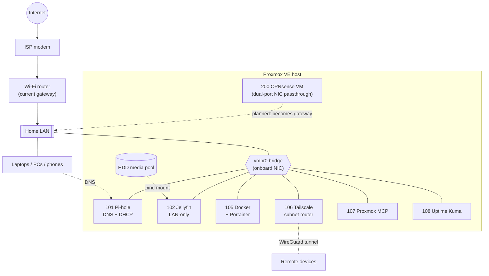

# Zach's Showcase

A running record of the technology I build, break, and fix outside of work. Every project here is something I actually run, with the configs, the design decisions, and the troubleshooting stories that came out of it.

The homelab is the first chapter. As I pick up new tools and platforms they get their own top-level folder, so this repo is meant to keep growing.

| Area | What's inside |
| --- | --- |
| [Homelab](homelab/) | A Proxmox VE server running DNS, media, containers, VPN, monitoring, an AI-assistant control plane, and a virtualized firewall |
| _More to come_ | New areas are added from [`_template/`](_template/) |

---

## Highlights

- **Found and fixed a backup job that had silently failed for three months.** I traced it to a misnamed storage target, extended coverage to every guest (several had never been backed up), and restored protection the same day. [Read more](homelab/proxmox-host/#lessons-learned)
- **Built a firewall VM with dedicated network hardware passed through to it**, staged next to the live network so day-to-day traffic was never disrupted. [Read more](homelab/opnsense/)
- **Set Claude up to administer the lab through a self-hosted MCP server**, with a written runbook, its own credentials, and an audit trail. I also fixed a bug in that server that had filled its memory file with noise (about 95% of 187 KB). [Read more](homelab/proxmox-mcp/)
- **Built every service on a default-deny design:** one container per service, a firewall policy for each, no SSH into containers, and patching and backups on a weekly schedule.

## Homelab at a glance

A single Proxmox VE host (Intel i7-10700K, 8 cores, SSD + HDD tiers) running lightweight LXC containers for each service, plus VMs where a full OS is required. Everything is default-deny on the firewall, patched weekly, and backed up weekly.

### Skills on display

- **Virtualization:** Proxmox VE, LXC vs. VM tradeoffs, PCIe passthrough with IOMMU, storage tiering (lvmthin vs. directory pools)
- **Networking:** DNS and DHCP with Pi-hole, a staged OPNsense firewall build, subnet routing over Tailscale, planned VLAN segmentation
- **Security:** key-only SSH, SSH disabled inside containers, per-guest default-deny firewalls, security groups for isolation, brute-force lockout
- **Operations:** cron-driven patching, vzdump backups with retention, uptime monitoring, change logs for every session
- **Automation and AI:** a self-hosted MCP server that lets Claude administer the lab through a skill with guardrails, and a code fix to that server

### Services

| Service | Category | Type | Role | Write-up |
| --- | --- | --- | --- | --- |
| Proxmox VE | Hypervisor | Bare-metal host | Hypervisor, storage, backups, patching | [proxmox-host](homelab/proxmox-host/) |
| Pi-hole | DNS + DHCP | LXC | Network-wide DNS filtering and DHCP | [pihole](homelab/pihole/) |
| Jellyfin | Media server | LXC | Media server, intentionally LAN-only | [jellyfin](homelab/jellyfin/) |
| Docker + Portainer | Containers | LXC | Container host for app workloads | [docker](homelab/docker/) |
| Tailscale | VPN | LXC | VPN subnet router for remote access | [tailscale](homelab/tailscale/) |
| Proxmox MCP | AI automation | LXC | MCP server so Claude can manage the lab | [proxmox-mcp](homelab/proxmox-mcp/) |
| Uptime Kuma | Monitoring | LXC | Service health monitoring | [uptime-kuma](homelab/uptime-kuma/) |
| OPNsense | Firewall / router | VM | Firewall/router, staged for cutover | [opnsense](homelab/opnsense/) |

### Topology

Design conventions used throughout:

- **VMID matches the last IP octet** (container 101 lives at `.101`), so the address of any service is obvious from its ID.
- **Static servers sit outside the DHCP pool**, which Pi-hole serves from the top of the range.
- **Fast/slow storage split:** container root disks live on SSD; bulk media and backups live on HDD.
- **No SSH into containers.** Administration goes through `pct exec` from the host, and SSH is masked on every LXC.

See the [homelab overview](homelab/) for storage layout, patching, backups, and the roadmap.

---

## A note on what's public

This repo is written from my private network documentation. LAN addresses, credentials, token identifiers, device names, and open hardening items have been removed or generalized. Configs shown are sanitized and representative of what runs, not copy-paste dumps.
